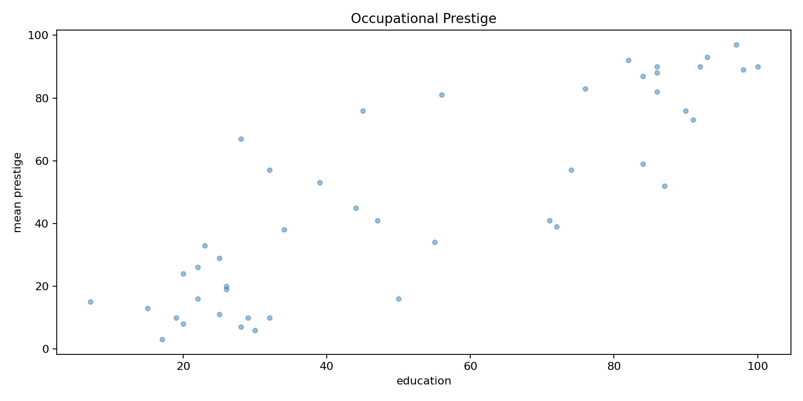

# Occupational Prestige — executed results

## Decision question
How are occupational education scores and prestige associated?

## Evidence
Among 45 complete observations, Pearson r = 0.852 and Spearman rho = 0.839.

Raw rows: 45. Rows used: 45. Excluded for missing/nonfinite required values or invalid denominator: 0.

## Method
Complete-pair scatter plot of education and prestige, with Pearson and Spearman correlations. No regression adjustment or causal claim.

## Interpretation and limitations
Occupational aggregates and historical scores cannot represent individual outcomes. No causal inference, significance claim or production deployment is implied. Missing values are not imputed; identical rows are retained. Small or repeated samples limit uncertainty interpretation.

## Recommended next decision
Review source score definitions before interpreting magnitude.

## Reproducibility
Source and exact downloaded-byte SHA256 are recorded in run_manifest.json. SQL results are in answer.csv and analysis.sqlite. Review quality_audit.csv before interpretation.
